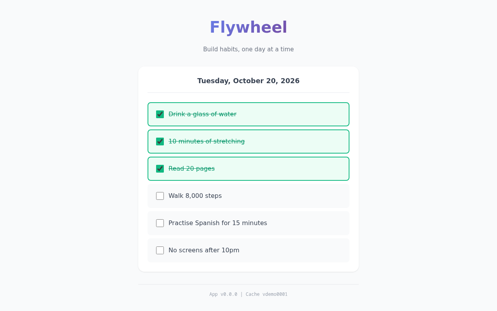
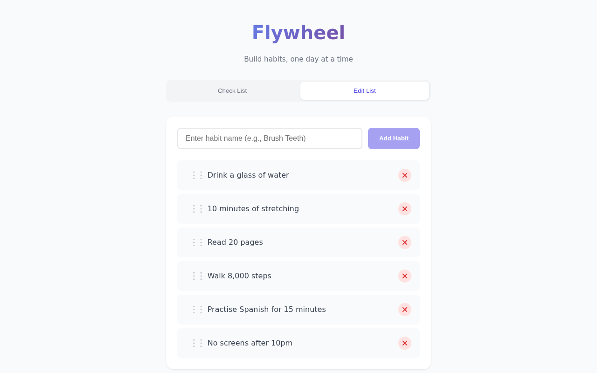
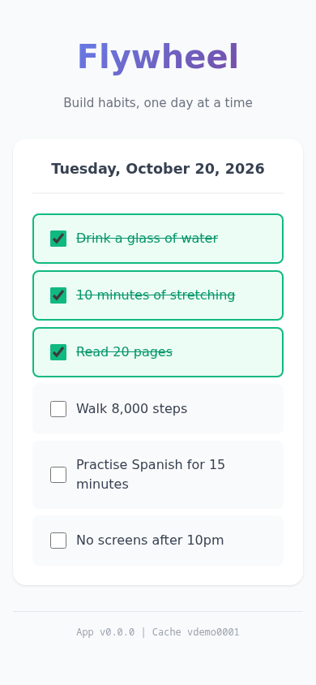
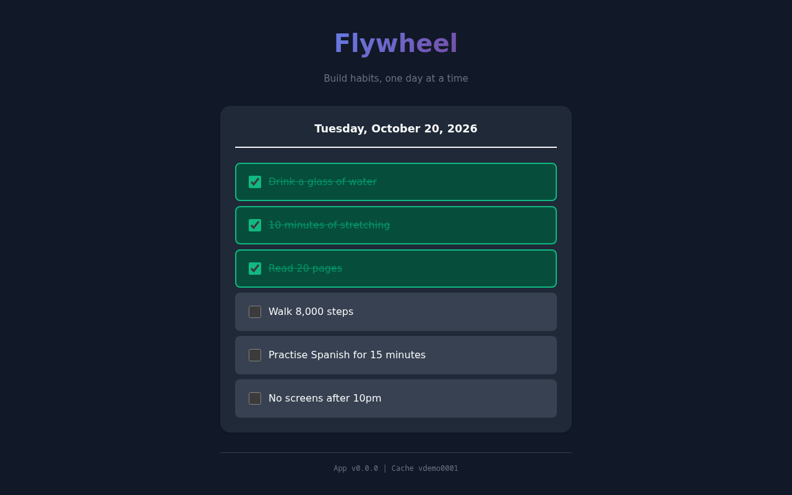

<div align = "center">
  
  <h1>Flywheel</h1>

  A simple, client-side only Progressive Web App (PWA) for building habits.
</div>

## Features

- Add and track daily habits
- Installable PWA
- Local storage (no backend required)
- Dark mode support
- Automated releases with semantic versioning

## Screenshots

### Today's habits



Tick off each habit as you complete it today. Completed habits turn green, so you can see at a glance what is left.

### Edit your habit list



Add new habits, drag them into the order you do them, or remove the ones you no longer need.

### On your phone



Flywheel is an installable Progressive Web App, so it works like a native app on your phone. Your habits stay on your device, with no account or server.

### Dark mode



Flywheel follows your system's light or dark setting automatically.

Screenshots use fictional test data and are regenerated with `make screenshots`
(see [`var/marketing/screenshots`](var/marketing/screenshots/README.md)).

## Quick Start

```bash
docker run -p 8080:80 ghcr.io/jamesread/flywheel:latest
```

The app will be available at `http://localhost:8080`.

See [frontend/README.md](./frontend/README.md) for detailed documentation.
